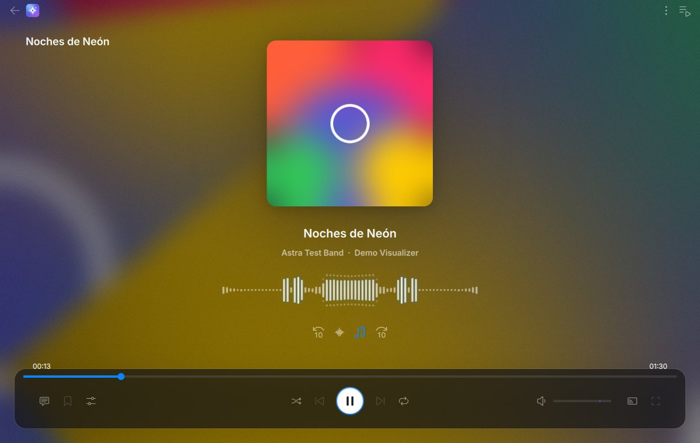
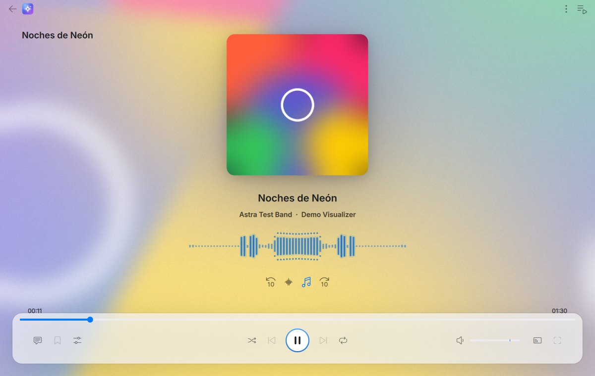
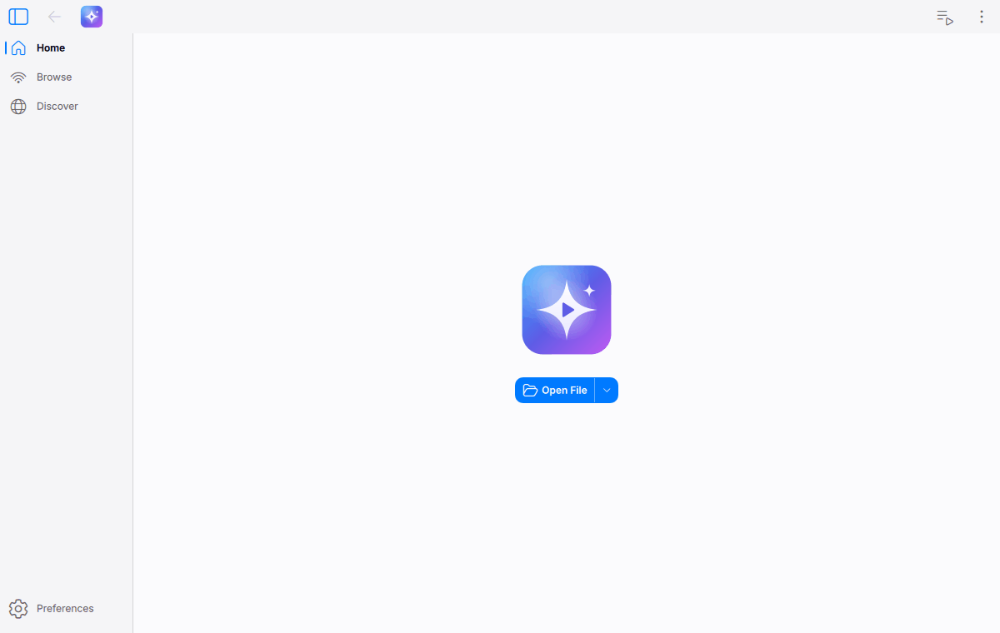

  

<h1 align="center">Astra Media</h1>

  Un reproductor multimedia bonito, fluido y con animaciones, basado en <a href="https://www.videolan.org/vlc/">VLC media player</a>.

  

  
  

## Qué tiene de especial

Astra Media es una versión modificada de VLC 4 con una interfaz rediseñada al estilo Apple. Por dentro sigue siendo VLC, así que reproduce prácticamente cualquier archivo, disco o emisión.

- **Visualizador de audio de verdad.** Al reproducir música ya no aparece un cono en medio: verás la portada redondeada, el título y unas barras que reaccionan al espectro real de la canción (graves en el centro, agudos hacia los lados). Lo calcula un analizador de espectro propio (`modules/audio_filter/astra_spectrum.c`) y la interfaz lo sincroniza con lo que escuchas.
- **Fondo vivo.** Detrás del reproductor se mueve un fondo hecho con los colores de la portada, desenfocado y animado, que respira con los graves.
- **La portada respira.** Late suavemente con la música y se encoge un poco al pausar, como en Apple Music.
- **Barra de control flotante** tipo cristal, con esquinas redondeadas y sombra.
- **Colores de Apple** en modo claro y oscuro: azul del sistema como color de acento, grises de macOS e iOS, verde en los interruptores.
- **Animaciones con muelle** en botones, transiciones suaves entre pantallas y tiempos más pausados.
- **Marca propia:** nombre, icono y logotipo de Astra Media, sin el cono de VLC.
- **En español.** La interfaz sigue el idioma de Windows e incluye las traducciones al español de todo lo nuevo.

## Descargar para Windows

Cada cambio en la rama `master` se compila automáticamente. Descarga el ZIP de la versión [**nightly**](../../releases/tag/nightly), descomprímelo donde quieras y abre **Astra Media.exe**. No hace falta instalar nada y no afecta a VLC si ya lo tienes instalado.

## Compilar

La compilación de Windows está en [`.github/workflows/windows.yml`](.github/workflows/windows.yml). Usa el contenedor oficial de VideoLAN y sus librerías precompiladas, igual que las compilaciones nocturnas de VLC. Para el resto de sistemas sirven las instrucciones originales de VLC en [`README-VLC.md`](README-VLC.md) y [`INSTALL`](INSTALL).

> No modifiques `contrib/`, `extras/tools/`, `extras/ci/` ni `extras/package/win32/`: las librerías precompiladas se localizan por el último cambio en esas carpetas y, si cambian, la compilación tendría que rehacerlas todas.

## Licencias y créditos

Astra Media es software libre. Se basa en **VLC media player**, creado por los voluntarios de [VideoLAN](https://www.videolan.org/), y se distribuye bajo las mismas licencias:

- El reproductor y la interfaz Qt, bajo la [GNU GPL versión 2 o posterior](COPYING).
- libVLC y los módulos, bajo la [GNU LGPL versión 2.1 o posterior](COPYING.LIB), salvo donde se indique otra cosa.

Los créditos originales están en [`AUTHORS`](AUTHORS) y [`THANKS`](THANKS). La lista de archivos modificados, con fecha, está en [`CAMBIOS-ASTRA.md`](CAMBIOS-ASTRA.md).

**VLC** y el logotipo del cono son marcas de VideoLAN. Astra Media es un proyecto independiente, no está afiliado ni respaldado por VideoLAN, y por eso usa su propio nombre e icono.
